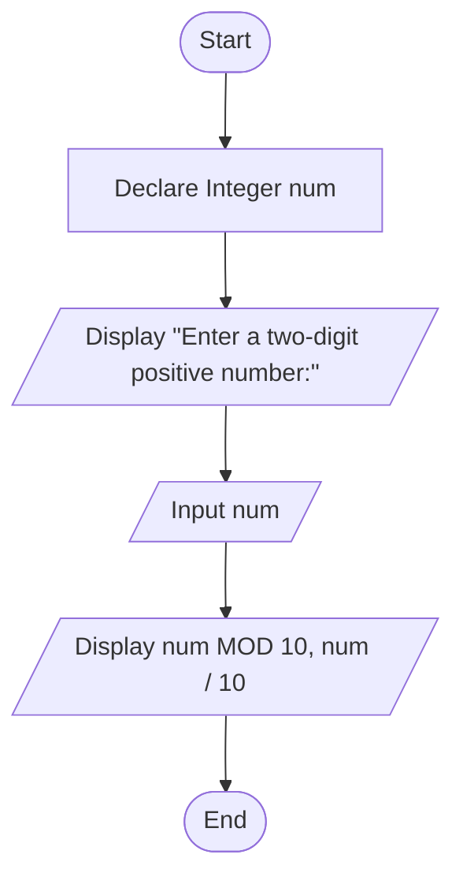

# Assignment: Reverse Digits of a Two-Digit Positive Integer

## 1. Problem Description
Write a program to accept a two-digit positive integer from the user and display the digits of that number in opposite (reversed) order.

---

## 2. Problem Analysis & Thinking Steps
1. **Input Identification**:
   - The user inputs a single two-digit positive integer (`num`).
2. **Core Logic & Mathematical Separation**:
   - To separate the digits without string manipulation, use standard arithmetic operators:
     - **Modulus (`num MOD 10` or `num % 10`)**: Extracts the remainder, which represents the ones digit (second digit).
     - **Integer Division (`num / 10`)**: Extracts the quotient, which represents the tens digit (first digit).
3. **Displaying Reversed Order**:
   - By printing `num MOD 10` first, followed by `num / 10`, the program effectively displays the number in reverse order.
4. **Efficiency & Usability**:
   - Minimal variable declarations (only `num` is required).
   - Friendly user prompts for clear data entry.

---

## 3. Pseudocode
```text
Step 1: Start
Step 2: Declare Integer num
Step 3: Display "Enter a two-digit positive number: "
Step 4: Input num
Step 5: Display num MOD 10, num / 10
Step 6: End
```

---

## 4. Flowchart (Mermaid.js)

