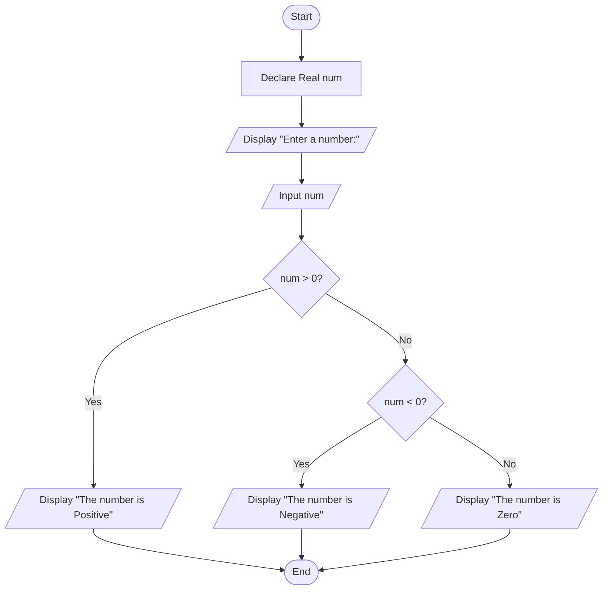

# Assignment: Number Inspection (Positive, Negative, or Zero)

## 1. Problem Description
Write a program to accept a number from the user and check whether the number is **Positive**, **Negative**, or **Zero**.

---

## 2. Problem Analysis & Thinking Steps
1. **Input Identification**:
   - The program prompts the user to input a single number (`num`).
2. **Data Types**:
   - Declare `num` as `Real` (or `Float`/`Integer`) to support integer and fractional values.
3. **Decision Logic (Nested Conditions)**:
   - Check if `num > 0`:
     - **True**: Display `"The number is Positive"`.
     - **False**: Check if `num < 0`:
       - **True**: Display `"The number is Negative"`.
       - **False**: Display `"The number is Zero"`.
4. **User Interaction**:
   - Provide clear and friendly output messages to communicate the results.

---

## 3. Pseudocode
```text
Step 1: Start
Step 2: Declare Real num
Step 3: Display "Enter a number: "
Step 4: Input num
Step 5: If num > 0 Then
            Display "The number is Positive"
        Else
            If num < 0 Then
                Display "The number is Negative"
            Else
                Display "The number is Zero"
            End If
        End If
Step 6: End
```

---

## 4. Flowchart (Mermaid.js)

