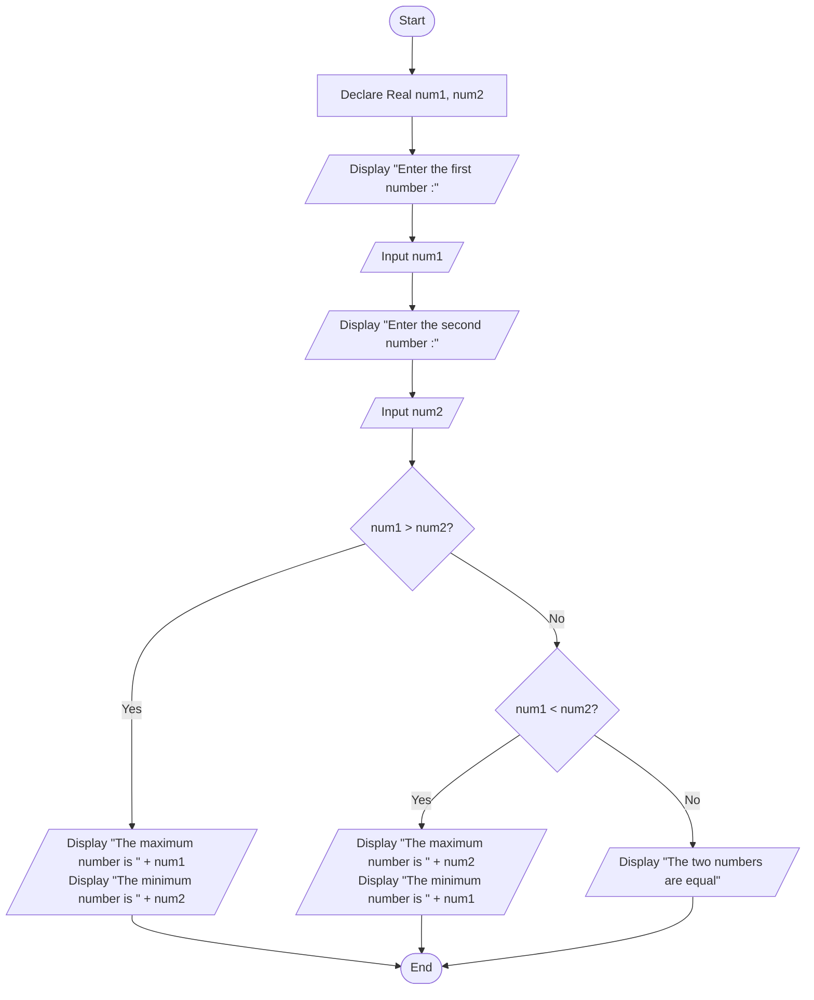

# Assignment: Number Comparison (Maximum, Minimum, or Equal)

## 1. Problem Description
Write a program to accept two real numbers from the user and determine which number is the **maximum** and which is the **minimum**. If the two numbers are equal, the program should display a message stating that they are equal.

---

## 2. Problem Analysis & Thinking Steps
1. **Input Identification**:
   - Prompt the user to enter two numbers (`num1` and `num2`).
2. **Data Types**:
   - Declare `num1` and `num2` as `Real` numbers to allow decimal and real numeric inputs.
3. **Decision & Comparison Logic (Nested Conditional Structures)**:
   - Compare `num1` and `num2` using relational operators (`>`, `<`):
     - **If `num1 > num2`**:
       - `num1` is the Maximum number.
       - `num2` is the Minimum number.
     - **Else (If `num1` is not greater than `num2`)**:
       - Check **If `num1 < num2`**:
         - **True**: `num2` is the Maximum number, and `num1` is the Minimum number.
         - **False**: The two numbers are equal (`num1 == num2`).
4. **User Interaction**:
   - Provide clear and friendly prompts to guide the user during input.

---

## 3. Pseudocode
```text
Step 1: Start
Step 2: Declare Real num1, num2
Step 3: Display "Enter the first number : "
Step 4: Input num1
Step 5: Display "Enter the second number : "
Step 6: Input num2
Step 7: If num1 > num2 Then
            Display "The maximum number is ", num1
            Display "The minimum number is ", num2
        Else
            If num1 < num2 Then
                Display "The maximum number is ", num2
                Display "The minimum number is ", num1
            Else
                Display "The two numbers are equal"
            End If
        End If
Step 8: End
```

---

## 4. Flowchart (Mermaid.js)

