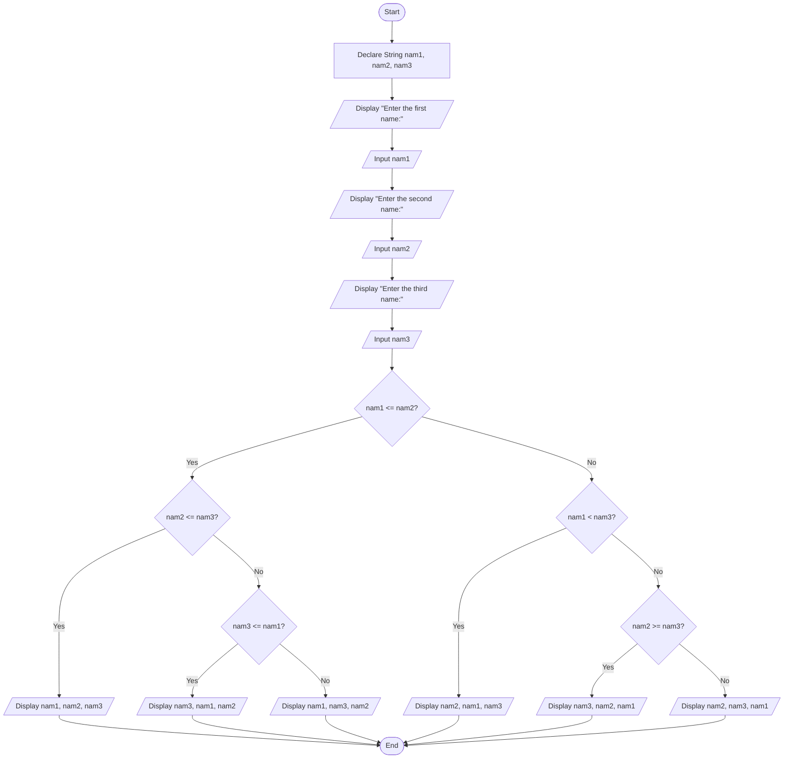

# Assignment: Sorting Three Names in Alphabetical Order

## 1. Problem Description
Design a program to accept three names from the user and display them organized in **alphabetical order** (lexicographical sequence).

---

## 2. Problem Analysis & Thinking Steps
1. **Input Identification**:
   - Prompt the user to enter three string names (`nam1`, `nam2`, `nam3`).
2. **Data Types & String Comparison**:
   - Declare variables as `String` (`nam1`, `nam2`, `nam3`).
   - Use relational operators (`<=`, `<`, `>=`) to evaluate character-by-character ASCII/lexicographical order.
3. **Logic & Decision Structure**:
   - Utilize nested `If-Else` conditional statements to systematically test all 6 possible permutation orderings of the three names.
4. **User Interaction & Usability**:
   - Display clear prompts for inputs and present the resulting sorted list clearly.

---

## 3. Pseudocode
```text
Step 1: Start
Step 2: Declare String nam1, nam2, nam3
Step 3: Display "Enter the first name:"
Step 4: Input nam1
Step 5: Display "Enter the second name:"
Step 6: Input nam2
Step 7: Display "Enter the third name:"
Step 8: Input nam3
Step 9: If nam1 <= nam2 Then
            If nam2 <= nam3 Then
                Display nam1, ", ", nam2, ", ", nam3
            Else
                If nam3 <= nam1 Then
                    Display nam3, ", ", nam1, ", ", nam2
                Else
                    Display nam1, ", ", nam3, ", ", nam2
                End If
            End If
        Else
            If nam1 < nam3 Then
                Display nam2, ", ", nam1, ", ", nam3
            Else
                If nam2 >= nam3 Then
                    Display nam3, ", ", nam2, ", ", nam1
                Else
                    Display nam2, ", ", nam3, ", ", nam1
                End If
            End If
        End If
Step 10: End
```

---

## 4. Flowchart (Mermaid.js)

