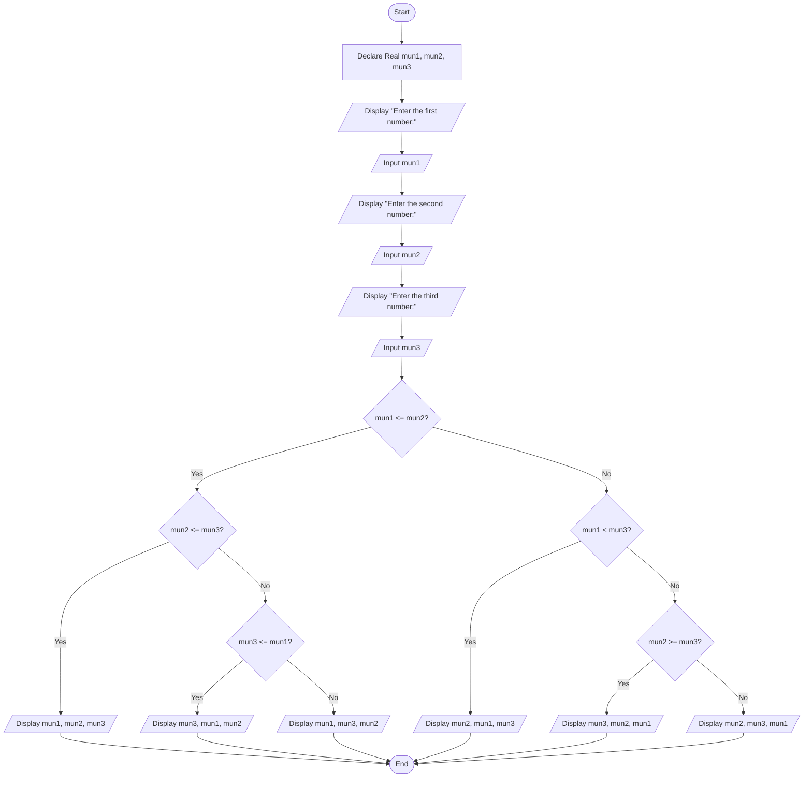

# Assignment: Sorting Three Numbers in Ascending Order

## 1. Problem Description
Design a program to accept three numeric values from the user and display them in **ascending order** (from smallest to largest).

---

## 2. Problem Analysis & Thinking Steps
1. **Input Identification**:
   - Prompt the user to enter three numeric values (`mun1`, `mun2`, `mun3`).
2. **Data Types & Numerical Logic**:
   - Declare variables as `Real` (or `Numeric`) to support decimal or integer inputs (`mun1`, `mun2`, `mun3`).
   - Use relational operators (`<=`, `<`, `>=`) to evaluate direct numerical magnitude relationships.
3. **Decision Structure**:
   - Utilize nested `If-Else` conditional statements to evaluate all 6 possible permutation paths of numerical order.
4. **User Interaction**:
   - Provide user-friendly prompts for each number and output the sorted sequence clearly.

---

## 3. Pseudocode
```text
Step 1: Start
Step 2: Declare Real mun1, mun2, mun3
Step 3: Display "Enter the first number:"
Step 4: Input mun1
Step 5: Display "Enter the second number:"
Step 6: Input mun2
Step 7: Display "Enter the third number:"
Step 8: Input mun3
Step 9: If mun1 <= mun2 Then
            If mun2 <= mun3 Then
                Display mun1, ", ", mun2, ", ", mun3
            Else
                If mun3 <= mun1 Then
                    Display mun3, ", ", mun1, ", ", mun2
                Else
                    Display mun1, ", ", mun3, ", ", mun2
                End If
            End If
        Else
            If mun1 < mun3 Then
                Display mun2, ", ", mun1, ", ", mun3
            Else
                If mun2 >= mun3 Then
                    Display mun3, ", ", mun2, ", ", mun1
                Else
                    Display mun2, ", ", mun3, ", ", mun1
                End If
            End If
        End If
Step 10: End
```

---

## 4. Flowchart (Mermaid.js)

