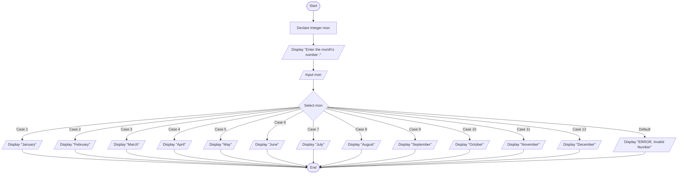

# Self-Exercise: Month Name Lookup Using Select Case Structure

## 1. Problem Description
Design a program whose main goal is to receive a number from the user representing a month (from `1` to `12`) and display the corresponding month's name (from `January` to `December`). If the entered integer is outside the set `1-12`, the program must display an error message: `"ERROR, Invalid Number"`.

---

## 2. Problem Analysis & Thinking Steps
1. **Input Identification**:
   - Prompt the user to enter a single integer representing a month (`mon`).
2. **Data Type**:
   - Declare `mon` as an `Integer` variable.
3. **Control Structure Efficiency (Nested `If` vs. `Select Case`)**:
   - **Why avoid nested `If` clauses?** Using nested `If-Else` statements for 12 distinct conditions is complex, inefficient, and requires multiple sequential evaluation steps.
   - **Why use `Select Case`?** The `Select Case` (or `switch`) structure evaluates a single test expression (`mon`) once and directly branches to the matching `case` value, making the code cleaner, faster, and easier to read and maintain.
4. **Validation & Error Handling**:
   - Include a `case default` block to catch any invalid month number outside the range `1–12` and output `"ERROR, Invalid Number"`.
5. **User Interaction**:
   - Provide clear, friendly prompts for data input.

---

## 3. Pseudocode
```text
Step 1: Start
Step 2: Declare Integer mon
Step 3: Display "Enter the month's number : "
Step 4: Input mon
Step 5: Select mon
            case 1: Display "January"
            case 2: Display "February"
            case 3: Display "March"
            case 4: Display "April"
            case 5: Display "May"
            case 6: Display "June"
            case 7: Display "July"
            case 8: Display "August"
            case 9: Display "September"
            case 10: Display "October"
            case 11: Display "November"
            case 12: Display "December"
            case default: Display "ERROR, Invalid Number"
        End Select
Step 6: End
```

---

## 4. Flowchart (Mermaid.js)

