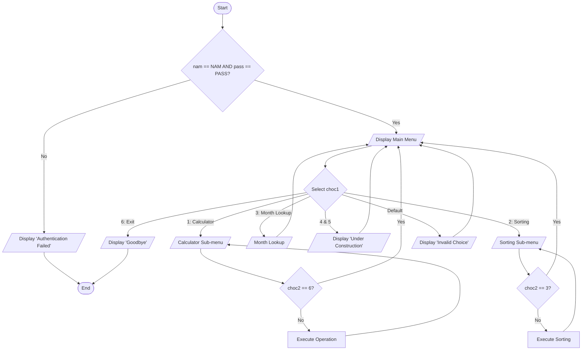

# Self-Exercise: Multi-Utility Interactive CLI System

## 1. Problem Description
Design a multi-purpose interactive console application that integrates several algorithms (Calculator, Name/Number Sorter, Month Lookup, Login System) into a single unified menu-driven program. The system includes authentication, sub-menus with "Go Back" functionality, loop-driven navigation, and graceful error handling.

---

## 2. Problem Analysis & Thinking Steps
1. **System Architecture & Modular Integration**:
   - Combine independent algorithms (Login authentication, Arithmetic Calculator, Sorting algorithms, Month Lookup) into one structured program.
2. **Control Flow & User Interface**:
   - **Authentication**: Verify credentials (`NAM = "Creator"`, `PASS = "RTs"`) before granting main menu access.
   - **Main Menu Loop (`Do-While`)**: Keep the application active until the user explicitly selects `[6] Exit`.
   - **Nested Branching (`Select Case`)**: Use multi-way branching for main options and nested sub-menus.
   - **Sub-menu Navigation**: Include a `Go Back` option in sub-menus to return to the main menu without exiting.
3. **Defensive Programming**:
   - Use `case default` fallbacks to handle invalid menu selections.
   - Display informative "under construction" messages for unfinished modules (Chatbot, Others).
4. **User Experience (UX)**:
   - Provide ASCII borders and responsive prompts for clear feedback.

---

## 3. Pseudocode
```text
Step 1: Start
Step 2: Constant String NAM = "Creator", PASS = "RTs"
Step 3: Declare String nam, pass
Step 4: Declare Integer choc1, choc2
Step 5: Display "Welcome to the Great System!"
Step 6: Display "First: log-in to the system."
Step 7: Display "Enter username: "
Step 8: Input nam
Step 9: Display "Enter password: "
Step 10: Input pass
Step 11: If pass == PASS AND nam == NAM Then
             Display "Welcome back to the Great System! ", NAM
             Do
                 Display "Main Menu:"
                 Display "[1] Calculating  [2] Sorting  [3] Month lookup"
                 Display "[4] Chatbot      [5] Others   [6] Exit"
                 Input choc1
                 Select choc1
                     case 1:
                         Do
                             Declare Real num1, num2
                             Display "Calculator Menu: [1] Add [2] Sub [3] Mult [4] Div [5] Power [6] Back"
                             Input choc2
                             If choc2 != 6 Then
                                 Display "Enter 1st number: "
                                 Input num1
                                 Display "Enter 2nd number: "
                                 Input num2
                                 Select choc2
                                     case 1: Display num1, " + ", num2, " = ", num1 + num2
                                     case 2: Display num1, " - ", num2, " = ", num1 - num2
                                     case 3: Display num1, " * ", num2, " = ", num1 * num2
                                     case 4: Display num1, " / ", num2, " = ", num1 / num2
                                     case 5: Display num1, " ^ ", num2, " = ", num1 ^ num2
                                     case default: Display "ERROR: Invalid choice."
                                 End Select
                             End If
                         While choc2 != 6
                     case 2:
                         Do
                             Display "Sorting Menu: [1] Three Names [2] Three Numbers [3] Back"
                             Input choc2
                             If choc2 != 3 Then
                                 Select choc2
                                     case 1:
                                         Declare String nam1, nam2, nam3
                                         Display "Enter three names:"
                                         Input nam1, nam2, nam3
                                         // Alphabetical Sort Logic...
                                     case 2:
                                         Declare Integer num1, num2, num3
                                         Display "Enter three numbers:"
                                         Input num1, num2, num3
                                         // Ascending Numerical Sort Logic...
                                     case default: Display "ERROR: Invalid choice."
                                 End Select
                             End If
                         While choc2 != 3
                     case 3:
                         Declare Integer mon
                         Display "Enter month number [1-12]: "
                         Input mon
                         Select mon
                             case 1: Display "January"
                             ...
                             case 12: Display "December"
                             case default: Display "ERROR: Invalid month."
                         End Select
                     case 4, 5:
                         Display "Notice: Feature under construction."
                     case 6:
                         Display "Goodbye!"
                     case default:
                         Display "Invalid selection."
                 End Select
             While choc1 != 6
         Else
             Display "Authentication Failed."
         End If
Step 12: End
```

---

## 4. Flowchart (Mermaid.js)

